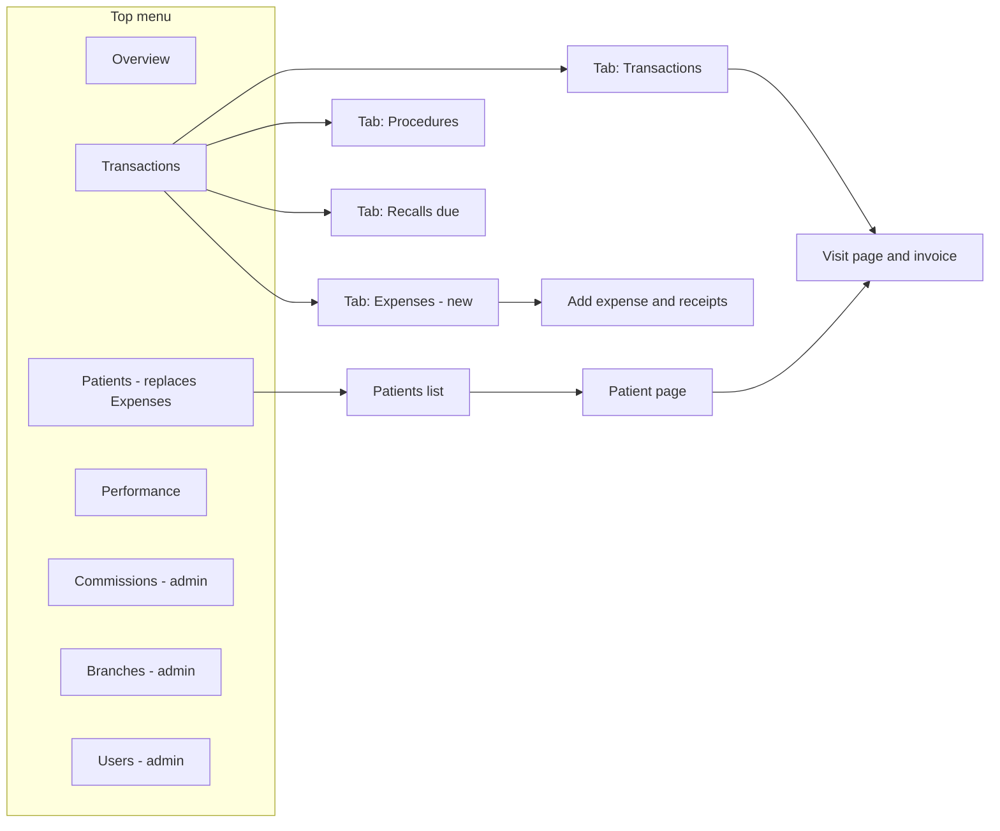
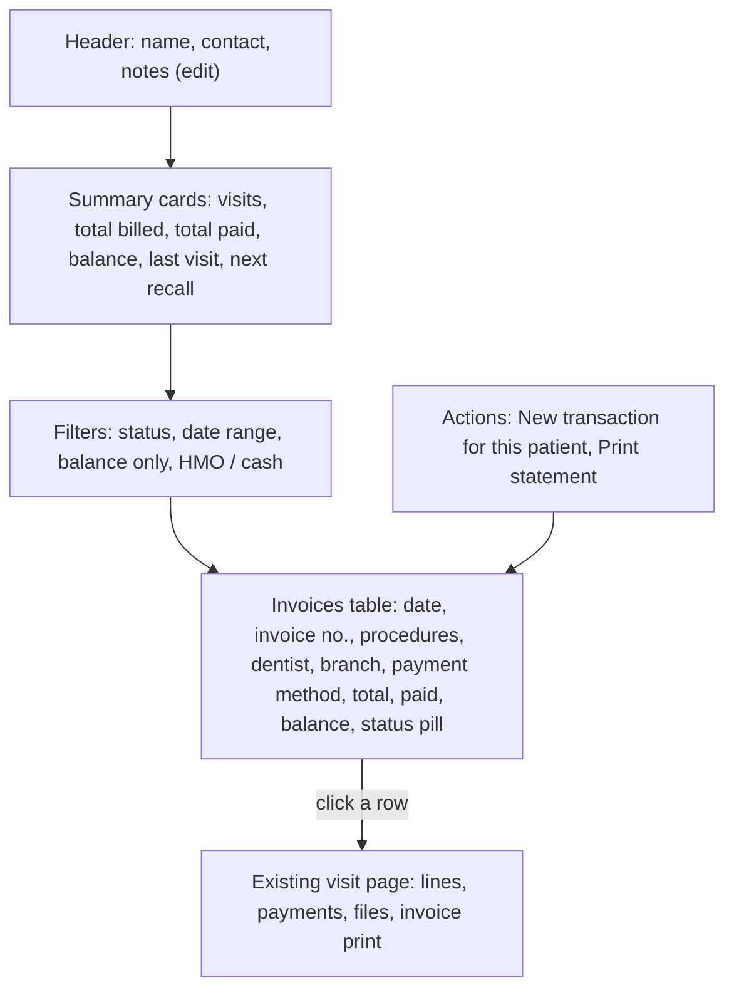
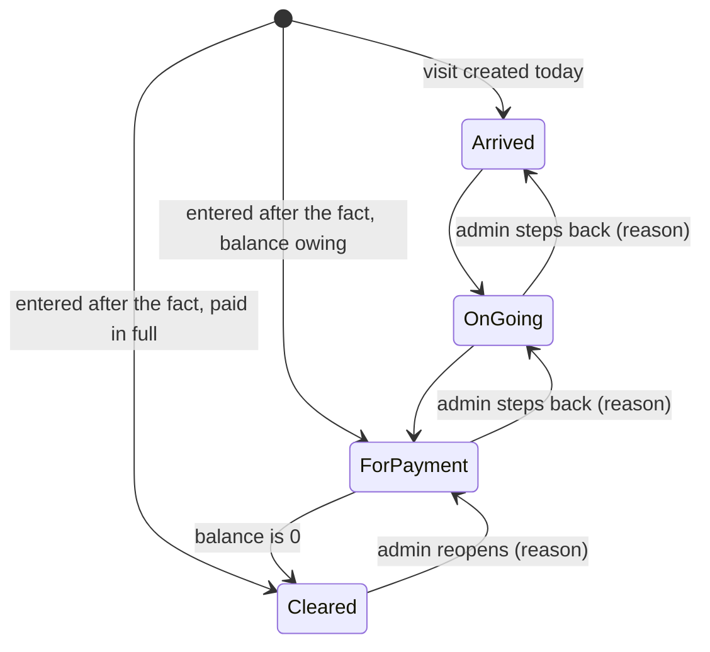
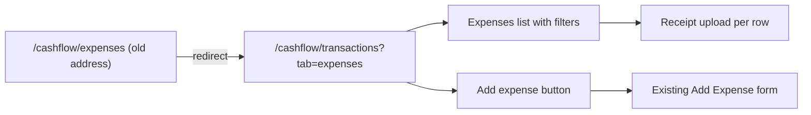
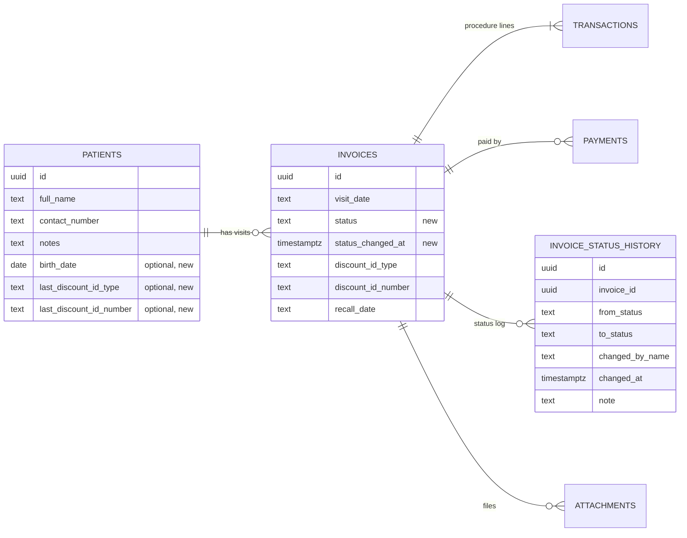
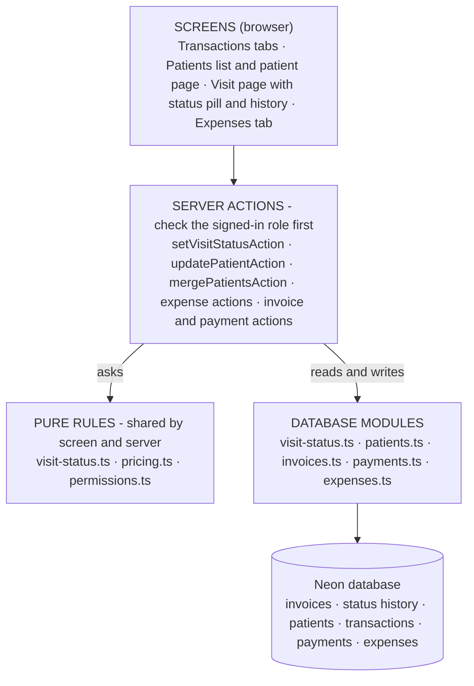
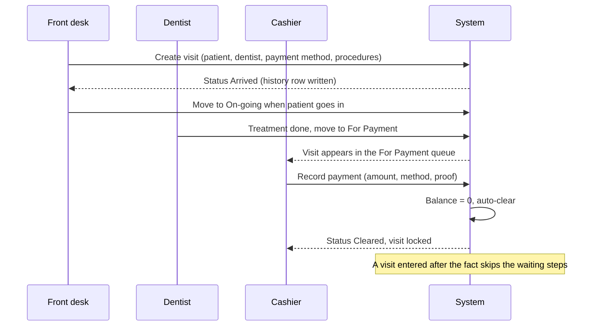

# Patients, Visit Status & Expenses — Flow and Architecture

**Project:** Cashflow application — ADT Dental Clinic
**Date:** October 11, 2026
**Updated:** October 11 — your decision applied: the **Expenses menu item becomes Patients**, and **Expenses moves inside Transactions as a new tab**.
**Status (updated October 11):** Phases 1, 2 and 3 and the PWD / Senior ID pre-fill and duplicate warning are **built** (see `IMPLEMENTATION_UPDATES.md`), together with the Today board on Overview, waiting-time numbers and the audit trail you added. Still waiting on your decisions: roles, ID photo, admin override, birth date. The rest of this document is the original design.
**Updated October 17:** HMO authorization (LOA / LOE), the end-of-day report, the commission report and check-in without procedures are built; their design is in section 15.
**Based on:** your four requests (move Expenses inside Transactions; a Patients page with each patient's invoices; internal tracking status On-going / Arrived / For Payment / Cleared; mandatory ID number for PWD / Senior) and the code as it is today. It builds on `TRANSACTION_WORKFLOW_AND_PRICELIST_PLAN.md` (sections 3.2 and 3.3 described status and roles in outline; this document replaces them with a full design).

---

## 1. Summary

| # | Request | What I propose | Size | State today |
|---|---|---|---|---|
| 1 | Move the **Expenses** tab inside Transactions | Expenses becomes a tab of the Transactions page (next to Procedures and Recalls due). The "Add Expenses" button moves from the header into that tab. The old address redirects. **The freed menu spot becomes Patients.** | S | Expenses is its own page and menu item; the add button sits in the header |
| 2 | **Patients** (menu item replacing Expenses): see the different invoices connected to a patient | A Patients page (searchable list with balance and last visit) and a **patient page** with every invoice, totals, balance, recall and a "new transaction for this patient" button | M | Patients exist as a table (name, contact, notes) but nothing shows them or their invoices |
| 3 | **Internal tracking**: On-going, Arrived, For Payment, Cleared | A **status on each visit** with a history of who moved it and when, simple rules (Cleared needs a zero balance), a coloured pill in the lists, filters, and an optional "Today" board | M–L | Not built |
| 4 | **PWD / Senior discount needs a mandatory ID number** | **Already built (October 9).** The ID type and number are required in the form and on the server, saved on the visit and printed on the invoice. Section 7 lists the small extras worth adding. | S (extras) | Done |

**What this document gives you:** the navigation and page structure (section 3), the patient pages (4), the status workflow with its rules and state machine (5), the Expenses move (6), the PWD / Senior check (7), the data model (8), the architecture and flow diagrams (9), the order of work (10), what you may have missed and what I would improve (11), and the decisions I need (12).

---

## 2. Where we are today (so the plan fits the code)

- **Menu:** Overview, Transactions, Expenses, then (role-based) Performance, Commissions, Branches, Users. The **Add Expenses** button lives in the header on every page.
- **Transactions page:** now has tabs — Transactions, Procedures, Recalls due — chosen by a `?tab=` address parameter on one page.
- **Expenses:** its own page at `/cashflow/expenses` (newest 200, receipt upload per row). Expenses can be **added** but there is no edit or delete on screen, and no search, date filter or paging.
- **Patients:** a `patients` table (name, contact number, notes). Matching is **by name only**. They appear only as the typeahead on the transaction form. A visit (invoice) links to a patient; its lines hold the procedures; payments belong to the invoice.
- **Status:** none. "Paid / Not paid" is worked out from payments. A visit is created and finished in one go.
- **Roles:** `admin`, `dentist`, `staff`. Most actions are open to every signed-in role; delete and settings are admin-only.
- **PWD / Senior ID:** required and validated (form and server), stored on the visit, printed on the invoice, masked on screen for non-admins.

---

## 3. Navigation and page structure

### 3.1 Proposed menu and tabs

- **Patients takes the place of Expenses in the top menu** (same position, so staff keep their muscle memory). It opens the patients list; a patient opens the patient page; an invoice on that page opens the existing visit page.
- **Expenses becomes the new tab inside Transactions**, next to Procedures and Recalls due. Four tabs: Transactions, Expenses, Procedures, Recalls due.
- The tab row still scrolls sideways on a small phone if needed.
- Tab choice stays in the address (`?tab=expenses`), so refresh, back button and shared links work. Patients has its own addresses: `/cashflow/patients` (list) and `/cashflow/patients/[id]` (patient page), with Patients highlighted in the menu.
- The Patients menu item is visible to every signed-in role at first (see section 11.1, item 6).

### 3.2 What changes in the code

| Area | Change |
|---|---|
| `transactions/page.tsx` | Adds one more tab value (`expenses`). Each tab loads only its own data. |
| `transactions-tabs.tsx` | Four tabs (Transactions, Expenses, Procedures, Recalls due); horizontal scroll on small screens. |
| `cashflow-nav.tsx` | Replace the "Expenses" menu link with **"Patients"** (`/cashflow/patients`) in the same position, and remove the "Add Expenses" button from both header areas (desktop and mobile panel). |
| `app/cashflow/patients/page.tsx` | **New** route for the patients list (the patient page is `patients/[id]`). The existing sign-in gate already covers every `/cashflow/*` address. |
| `cashflow/layout.tsx` | No longer loads suppliers and branches for the header button (the Expenses tab loads them itself). One query less on every page. |
| `app/cashflow/expenses/page.tsx` | Becomes a redirect to `/cashflow/transactions?tab=expenses`. Its table moves into a component used by the tab. |
| `expense-actions.ts` | `revalidatePath` points at the Transactions page. |
| Dashboard links | Any link to `/cashflow/expenses` is updated (only the menu links there today). |

Nothing is deleted from the database; this is a re-arrangement.

---

## 4. Patients page (top-level menu)

### 4.1 Patient list

| Column | Source |
|---|---|
| Name (link to the patient page) | `patients.full_name` |
| Contact number | `patients.contact_number` |
| Last visit | latest invoice date |
| Visits | count of invoices of type Visit |
| **Balance due** | sum of invoice totals minus payments, across all their invoices |
| **Status today** | status pill if they have a visit today (after section 5) |
| Recall | next pending recall date, if any |

Search by name or contact number; filters: **has a balance**, **recall due**, **seen in the last 30 / 90 days**, **not seen in 6 months**; paging like the transactions list. Admin and staff can add a patient directly (name, contact, notes) without making a transaction, and edit their details.

### 4.2 Patient page (the invoices connected to the patient)

- The invoices table reuses the numbers already computed for the transactions list (total, collected, balance), so the figures always match.
- **New transaction for this patient** opens the existing Add form with the patient already filled in.
- **Print statement** (optional, suggested): one page listing the patient's invoices and balance — useful when a patient asks "how much do I still owe?".
- PWD / Senior ID on file is shown **masked** to non-admins; admin sees it in full (same rule as the visit page).
- Placeholder for later: a **Notes** section for the clinical progress notes feature (planned separately).

### 4.3 Data and queries

- `listPatientsPage({ q, filter, page })` — one query with a grouped join to invoices and payments (balance and last visit computed in the database, not in the browser). New index on `invoices(patient_id, visit_date)` keeps it fast.
- `getPatientProfile(id)` — patient row, totals, and the invoice list through the existing `getInvoiceSummaries`.
- `updatePatientAction` — name (re-checks the duplicate key), contact number, notes. Renaming a patient does not touch the name saved on old transactions.

### 4.4 Because patients are matched by name only

Two different people with the same name are treated as one, and "Santos, Maria" and "Maria Santos" are two. The Patients page will make these visible. Suggested (decision 8): an admin **Merge patients** action (moves the invoices of one record onto another and removes the duplicate), and optional **birth date** on the patient so same-name patients can be told apart.

---

## 5. Internal tracking status (On-going, Arrived, For Payment, Cleared)

### 5.1 The statuses

Your list was On-going, Arrived, For Payment, Cleared. The order a patient actually goes through is **Arrived → On-going → For Payment → Cleared** — please confirm (decision 2).

| Status | Meaning | Normally set by |
|---|---|---|
| **Arrived** | Patient checked in; the visit exists | Front desk (automatic on create) |
| **On-going** | Patient is with the dentist | Front desk or dentist |
| **For Payment** | Treatment done; waiting at the cashier | Dentist or front desk |
| **Cleared** | Paid in full and closed | Cashier or admin (or automatic, see 5.3) |

Status belongs to the **visit (invoice)**, not to a procedure line or to the patient.

### 5.2 State machine

**Rules (all checked on the server, not only hidden in the screen):**

| Rule | Detail |
|---|---|
| Forward one step at a time | Arrived → On-going → For Payment → Cleared. Skipping is not offered (except on create, below). |
| **Cleared needs balance due = 0** | For everyone, admins included. There is no override: record the payment first (it then clears itself). |
| Going backwards | Admin only, with a reason; logged. |
| Cleared visits are read-only | Lines, discounts and payments cannot be changed by non-admins. An admin can reopen (reason, logged). |
| Status does not change the money | Sales, net collection, commission and the dashboard keep following **payments received**, exactly as today. Status is a work-flow label (decision 4). |
| Reservations | A reservation fee is a payment, not a treatment. Proposed: reservations are created as **Cleared** (decision 3). |

### 5.3 What happens automatically

| Event | Status result |
|---|---|
| Visit created with **today's** date and nothing paid | **Arrived** |
| Visit created and the payment received covers the total | **Cleared** |
| Visit created with a **past date** (typed in from the paper booklet) | **Cleared** if paid in full, otherwise **For Payment** — no waiting steps for work that is already done |
| A payment brings the balance to 0 while the visit is **For Payment** | **Cleared** automatically (history says "system: balance paid") |
| A payment is removed from a **Cleared** visit (admin) | Back to **For Payment** |
| Existing visits (one-time backfill) | Paid in full → Cleared; otherwise For Payment |

This keeps today's habit working: if the clinic enters a whole visit and its payment in one go, nothing extra is asked.

### 5.4 Data model

| Table | Change |
|---|---|
| `invoices` | `status` (text, one of the four, with a database check so a wrong value cannot be saved; default `Cleared` for old rows), `status_changed_at` (time) |
| `invoice_status_history` (**new**) | `id`, `invoice_id` (cascade delete), `from_status`, `to_status`, `changed_by_user_id`, `changed_by_name`, `changed_at`, `note` |

- A text column with a check is used instead of a database enum on purpose: adding values to an enum has the "cannot be used in the same transaction" limitation that already affected earlier SQL files, and the four names are unlikely to change.
- The history table gives waiting times for free: arrival → on-going, on-going → for payment, for payment → cleared.
- One idempotent SQL file (`2026-10-visit-status.sql`) adds the columns, the history table, the check, the index and the backfill, and prints counts. You run it in Neon; I do not run database commands.

### 5.5 Server design

- `src/lib/cashflow/visit-status.ts` — **pure rules**: `STATUSES`, `nextStatus`, `canMove({ from, to, role, balanceDue, isAdminOverride })`, `defaultStatusOnCreate({ visitDate, today, totalDue, collected, type })`. Pure, so the same rules run in the form (what to offer) and on the server (what is allowed), and they can be checked with plain number-style tests.
- `src/lib/db/visit-status.ts` — `setVisitStatus(invoiceId, to, actor, note)`: reads the current status and balance, applies `canMove`, updates the invoice, writes a history row. The database service in use has no multi-step transactions, so the order is: update the invoice, then write the history; a history failure is logged and reported but the status stands (the same approach already used when saving a visit).
- `setVisitStatusAction` — a server action that checks the signed-in role first.
- **Hooks into existing flows:** `createInvoice` (default status), `updateInvoice` (refuse changes on a Cleared visit unless admin), payment actions (auto-clear and reopen after `recomputeInvoiceFees`), `deleteInvoice` (history is removed with the invoice), CSV import (status computed from the imported payments).

### 5.6 What staff see

- A **status pill** (Arrived grey, On-going blue, For Payment amber, Cleared green) in the transactions list, the visit page and the patient page.
- A one-click **"Move to …"** button next to the pill (only the allowed next step), and a small menu for admins (back / reopen with a reason).
- ~~Filters on the Transactions tab: Status~~ — built, then removed on request (October 12): the Transactions list has no Status column or filter; the cashier's queue is the Queue page.
- **Today board** (suggested, small once status exists): four columns for today's visits, per branch, so the front desk and cashier see the queue at a glance.
- Add / Edit form: no new field by default (status is automatic). Admin-only "Status" select on edit.

### 5.7 Who can do what

Two options (decision 5):

- **A — Keep today's roles (recommended first step).** Any signed-in user moves a visit forward; only admin goes back, reopens, or edits a Cleared visit. No new accounts or permissions to set up.
- **B — Add `front_desk` and `cashier` roles** with the permission table from the earlier plan (front desk creates and edits, cashier records payments and clears). This is a larger change to who can do what today, so it is better done after A has been used for a while.

---

## 6. Expenses inside Transactions

- The list and the **Add expense** button live in the Expenses tab. The existing add form, supplier lookup, duplicate warning and receipt upload are reused unchanged.
- The header button is removed (decision 10 asks whether you want to keep a shortcut there too).
- Old links and bookmarks keep working through the redirect.
- **Suggested while it is being moved** (not part of the move itself): search, a date range and a category filter, paging instead of "newest 200", a month total, and edit / delete for admins (the database already has the functions; the screen does not). See section 11.

---

## 7. PWD / Senior discount — mandatory ID number

**Already built on October 9.** How it works now:

- Choosing **PWD** or **Senior citizen** on a line (either one is flagged "needs ID" in the discount types table) shows **ID type** and **ID number**, both required.
- Checked **twice**: in the form and again on the server, so a request that skips the screen is also refused.
- Saved once per visit, printed on the invoice, masked (`•••• 1234`) on the visit page for everyone except admin.
- Old visits without an ID are not changed.

**Small additions I would suggest (decision 9):**

| Addition | Why |
|---|---|
| **Pre-fill** the last ID used by that patient | Saves typing at the counter; shown in the patient page too. Needs two columns on `patients`. |
| **Duplicate check** | Warn if the same ID number was used for a different patient name (a common sign of a typo or misuse). |
| **Photo of the ID** (optional, or required) | Uses the existing file uploader with a new kind "ID". Good evidence for the accountant; raises privacy duty (see section 11). |
| **Admin override with a reason** | For the patient who forgot the ID card: the visit can be saved without it only by an admin, with a written reason that is logged. Decide whether this is allowed at all. |
| **ID format hint** | Show an example per ID type; no hard format rule (formats differ by city). |

---

## 8. Data model — all changes in one place

| Table | Change | Phase |
|---|---|---|
| `invoices` | `status`, `status_changed_at`; index on `(patient_id, visit_date)` | 2, 3 |
| `invoice_status_history` | **new** | 3 |
| `patients` | optional: `birth_date`, `last_discount_id_type`, `last_discount_id_number` (and later HMO member number) | 2, 4 |
| `users` | role enum gains `front_desk`, `cashier` — **only if decision 5 is option B** (its own SQL file) | 5 |

How it ships, following the project's rules: one idempotent SQL file per phase in `scripts/sql/` that you run in the Neon SQL Editor; backfills that print counts; everything additive (nothing dropped); I never run installs, the dev server or database commands.

---

## 9. Architecture

### 9.1 Layers

The rule that makes this safe: **screens only ask; the server decides.** A hidden button is never the only protection, and the same pure rule file is used in both places so they cannot disagree.

### 9.2 Visit flow across the clinic

### 9.3 Safety and audit

- Every status move writes who, when, from, to and a note.
- Moves on a Cleared visit and all backwards moves need an admin and a reason.
- Personal data (PWD / Senior ID, contact numbers) is never put in addresses or logs and is masked for non-admins.
- Server actions return a plain result (`ok` or a message); they never throw to the browser.

---

## 10. Order of work

| Phase | Work | Depends on | Size |
|---|---|---|---|
| 1 | **Move Expenses** into the Transactions tabs; remove the header button and menu item; redirect; layout query clean-up | — | S |
| 2 | **Patients** (menu item replacing Expenses): list, patient page with invoices, balance, filters; add / edit patient; index | — | M |
| 3 | **Visit status**: pure rules, SQL + backfill, history, actions, pills, filters, auto-clear; locked when Cleared | Phase 2 helps (pill on the patient page) | M–L |
| 4 | **ID extras** (decision 9): pre-fill, duplicate warning, optional ID photo | Phase 2 (patient columns) | S |
| 5 | **Roles** `front_desk` / `cashier` and a permission table (only if option B) | Phase 3 | M |
| 6 | Improvements picked from section 11 | — | S–M each |

Phases 1, 2 and 4 are independent. Because the Expenses menu spot becomes Patients, I suggest releasing **1 and 2 together** so the menu changes once (otherwise Phase 1 simply removes the Expenses item and Patients appears with Phase 2); 3 is the largest and the one that changes day-to-day work, so it is best released after the patient pages are in use. Each phase ends with: type check and lint clean, pure-function checks, a walk through the browser **without saving**, and the implementation notes and project doc updated.

**Files by phase (expected):**

| Phase | New | Changed |
|---|---|---|
| 1 | `expenses-tab.tsx` (list), redirect | `transactions/page.tsx`, `transactions-tabs.tsx`, `cashflow-nav.tsx` (Expenses link removed; Patients link added once Phase 2 exists), `layout.tsx`, `expenses/page.tsx`, `expense-actions.ts` |
| 2 | `patients-list.tsx`, `patient-page.tsx`, `app/cashflow/patients/page.tsx`, `app/cashflow/patients/[id]/page.tsx`, `lib/db/patient-admin.ts`, `patient-admin-actions.ts`, SQL for the index and optional columns | `cashflow-nav.tsx` (Patients link), `patients.ts`, `transaction-form.tsx` (pre-select patient) |
| 3 | `lib/cashflow/visit-status.ts`, `lib/db/visit-status.ts`, `visit-status-actions.ts`, `status-pill.tsx`, `status-history.tsx`, `2026-10-visit-status.sql` | `schema.ts`, `invoices.ts`, `payment-actions.ts`, `transactions-table.tsx`, `transaction-detail.tsx`, `transactions-toolbar.tsx`, `transactions-query.ts`, CSV import |
| 4 | — | `schema.ts`, `invoices.ts`, `transaction-form.tsx`, `patients.ts` |
| 5 | `permissions.ts`, role SQL (own file) | every server action, `users-manager.tsx`, `user-schema.ts`, nav |

---

## 11. What you may have missed — and what I would improve

### 11.1 Gaps in the notes (things the requests do not say yet)

| # | Gap | Why it matters | Suggestion |
|---|---|---|---|
| 1 | **Visits typed in after the fact** | The clinic mostly enters visits from the paper invoice booklet. A live status flow (Arrived → On-going …) does nothing for those. | Automatic status by date and payment (5.3), so back-entry never gets stuck in "Arrived". |
| 2 | **Reservations** (reservation fee) | A reservation is money in, not a treatment in progress. | Create as Cleared; the reservation shows on the patient page. |
| 3 | **Same-name patients and spelling variants** | Matching is by name only; the Patients page will expose duplicates. | Merge tool, optional birth date, "possible duplicate" warning when adding a similar name. |
| 4 | **HMO details** | HMO visits normally need the member number and an approval / LOA number, and the HMO may pay only part (co-pay). Today neither is stored. | Add "Member no." and "Approval / LOA no." to the visit when the payment method is an HMO; later an "HMO claims" list (billed, paid). |
| 5 | **Edit and delete for expenses** | You can add an expense but not correct a typo on screen. | Admin edit / delete in the Expenses tab, with the receipt kept. |
| 6 | **Who may see the Patients page** | It lists contact numbers and balances of every patient. | Open to all signed-in roles at first (they already see the same on transactions); dentists see all, with the ID masked. Revisit with roles (phase 5). |
| 7 | **Printed official receipt requirements** | SC / PWD sales need the name and ID number on the receipt. | The invoice already prints the ID; confirm the exact wording and fields with the accountant (I am not giving tax advice). |
| 8 | **Walk-in vs appointment** | The queue is clearer when walk-ins are marked. | Optional "Walk-in" tick at check-in, shown on the board. |
| 9 | **No-shows and cancellations** | A visit created in advance that never happens has no status for it. | Add "Cancelled / No-show" as an optional fifth status outside the main path (decision 3). |
| 10 | **Data Privacy Act** | IDs, contact numbers and (later) clinical notes are personal data. | Role-based visibility, masking, no personal data in links or logs, a privacy notice and retention rule from the clinic. |

### 11.2 Improvements worth considering (by value for effort)

| Priority | Improvement | Size |
|---|---|---|
| High | **Today board** (four status columns per branch) — front desk and cashier see the queue at once | S once status exists |
| High | **Waiting-time numbers** from the status history (arrival to dentist, treatment to payment) | S |
| High | **Expenses**: search, date and category filters, paging, month total, admin edit / delete | S–M |
| High | **Audit trail** for edits to a Cleared visit, discounts and price changes (who, when, before / after) | M |
| Medium | **Patient statement** (print: invoices and balance) | S |
| Medium | **Merge patients** and duplicate warning | S–M |
| Medium | **HMO member / approval number** and HMO claims list | M |
| Medium | **Notification badge** on the Transactions tab ("3 visits waiting for payment") | S |
| Medium | **Month-end close** for the cashier: payments by method vs the Day End report | M |
| Medium | **Discount report**: PWD / Senior list with ID numbers, discounts by type and user (admin / cashier only) | S–M |
| Low | **Recall reminders** by SMS once recall dates are used (needs a provider and consent) | M |
| Low | **Tablet-friendly front desk form** (single column, large touch targets) | S |
| Low | **Automated tests** for the money and status rules (a small test setup). Today they are checked by hand-run scripts; tests would run on every change. Needs a test library added to the project, so it is your call. | S–M |
| Low | **Backups / export**: a monthly export of patients, invoices and payments to CSV, and confirmation that the database has point-in-time restore on | S |

---

## 12. Decisions I need from you

1. ~~Patients placement~~ **Decided:** Patients is a top-level menu item replacing Expenses; Expenses is a tab inside Transactions.
2. **Status order.** Is **Arrived → On-going → For Payment → Cleared** right (your list started with On-going)?
3. **Extra statuses.** Reservations created as Cleared — yes? Do you want **Cancelled / No-show** as an optional extra status?
4. **Does status change the numbers?** Recommendation: **no** — sales stay based on payments received. Should "Cleared" have any effect on reports?
5. **Roles.** Option A (today's roles, admin controls backwards moves) now and new `front_desk` / `cashier` roles later, or option B now? Can the **dentist** move a visit to For Payment?
6. **Auto-clear.** When a payment brings the balance to 0 on a For Payment visit, clear it automatically (recommended) or require a click by the cashier?
7. **Back-entry visits.** For visits with a past date, skip the waiting steps and set Cleared / For Payment automatically (recommended)?
8. **Patient details.** Add **birth date** and a **merge patients** tool? Anything else on the patient (address, e-mail, HMO member number)?
9. **ID extras.** Which of these do you want: pre-fill last ID, duplicate-ID warning, optional / required ID photo, admin override with a reason?
10. **Add Expenses button.** Only inside the Expenses tab (recommended), or also keep a shortcut in the header?
11. **Expenses improvements.** Include filters, paging and admin edit / delete in phase 1, or only move the tab?
12. **Order of work.** Phases 1 → 2 → 3 (recommended), or status first?

---

## 13. Risks

- **A status flow nobody keeps up** becomes noise. Mitigation: automatic statuses for back-entry, one-click next step, and a simple board; review use after four weeks.
- **Cleared = read-only** can frustrate staff who spot a typo. Mitigation: a clear "Reopen (admin)" path with a reason so corrections stay possible and visible.
- **Backfill is a guess for old data** (paid → Cleared, else For Payment). Cancelled or no-show records from the past need a manual status.
- **Patient balance across many invoices** must be computed in the database and indexed; done in the browser it would slow down as data grows.
- **Moving Expenses** breaks old bookmarks unless the redirect is kept; it will be.
- **Privacy:** the Patients page concentrates personal data in one place; masking and role rules must ship with it, not after.
- **Data volume is still small**, so this is the cheapest time to change the structure.

---

## 14. How each phase will be checked

| Phase | Checks |
|---|---|
| All | Type check and lint clean; each SQL file run twice on a copy (idempotent); backfills print counts; browser walk-through **without saving**; implementation notes and project doc updated. |
| 1 | Old `/cashflow/expenses` address lands on the Expenses tab; add expense and receipt upload still work from the tab; header has no Add Expenses button; menu has no Expenses item. |
| 2 | A patient with 3 invoices shows 3 rows whose totals, paid and balance match the transactions list; filters (balance, recall, last seen) work; "New transaction for this patient" pre-fills the name; non-admin sees the ID masked. |
| 3 | Pure-function cases: create today unpaid → Arrived; create paid in full → Cleared; past date unpaid → For Payment; Cleared with balance 500 refused for staff and for admin; payment to zero on For Payment auto-clears; back-step by non-admin refused on the server; edit of a Cleared visit by non-admin refused; history rows written for each move. |
| 4 | Pre-fill appears for a returning patient; the same ID on another name warns. |
| 5 | Front desk recording a payment is refused on the server; cashier editing a Cleared visit is refused. |

---

## 15. October 17 additions — design notes

### 15.1 HMO authorization (LOA / LOE)

- **Data:** two text columns on `invoices` (`loa_number`, `loe_number`, blank by default). A visit is an **HMO visit** when any of its payments or lines has an HMO provider as the payment method; this is worked out when needed (no stored flag), so a payment recorded later from the Payments panel counts too.
- **Why a rule on Cleared, not on check-in:** the LOA often arrives the day after the visit. Requiring it at check-in would block the queue; requiring it at billing is too late to chase. Cleared is the point where the visit is closed for editing, so that is where the LOA is mandatory. Everything before it (Arrived, On-going, For Payment, taking the HMO payment) works without it.
- **Where the rule lives:** `canMove`, `statusAfterPaymentChange` and `defaultStatusOnCreate` in `src/lib/cashflow/visit-status.ts` take a `loaMissing` flag. The server computes it from the database (`getHmoInfo`) on every status change and after every payment change, and the screens compute the same flag so the button explains the refusal before the click. An admin is not exempt: the LOA is part of the claim.
- **Old data:** a Cleared visit is never shown as "LOA pending", and the Cleared status of imported history is not touched.
- **Open:** the meaning of LOE; an LOA worklist and reminder; an LOA scan (the existing invoice attachments can hold it today).

### 15.2 End-of-day report

- **Source of rows:** `payments` received in the Manila day (00:00–24:00, UTC+8) for the branch, joined to the visit's lines for patient, dentist, procedures and the VAT / withholding tax shares; plus the day's visits with no payment (0.00) and the branch's expenses. Collections follow the **payment date**; charges follow the visit date.
- **Shared by the screen and both downloads:** `src/lib/cashflow/day-end.ts` builds one grid of cells; the page, the CSV and the Excel file all come from it, so they cannot disagree. The Excel writer (`xlsx.ts`) is a few dozen lines of XML in a stored zip — no new package.
- **Access:** any signed-in user; an admin may pick any branch or all, a user who belongs to a branch is kept to it (checked on the server, also for the download link).
- **Not built:** *Close day* (it would lock payments, which means a check in every place a payment can be saved, because the database service has no multi-step transactions), cash count and variance, PDF.

### 15.3 Commission report

- **Source:** the commission stored on each procedure line when it was saved (`commission_amount`), so rate changes never rewrite history. Filter by visit date, dentist and branch; admin only.
- **Open question for the clinic:** whether commission should be owed when the line is saved (today) or only as cash is collected (the spec's proposal). The second needs commission entries per payment and a backfill; it is not done.

### 15.4 Check-in without procedures

- **Why a placeholder line and not an empty visit:** the visit's patient, dentist and branch live on its procedure lines, and every list, board and report is built from lines. A visit with no lines would vanish from all of them. One placeholder line named "No procedures yet" (price 0) keeps the visit visible everywhere; it is replaced when real lines are saved, hidden from the form, and excluded from procedure statistics.
- **Gate:** For Payment and Cleared need a real procedure and a dentist (`visitReadinessIssue`), enforced by the server and mirrored on the buttons. A check-in always starts Arrived. A payment can't be taken until there are procedures.

## 16. October 19 additions — tier-based commission

### 16.1 Model

- **`dentist_commission_tiers`** (dentist → tier 1–3) is its own table, not a column on `users`: the sign-in query reads every `users` column, so a column there would break login until the migration was run.
- **`commission_tier_rates`** (tier × procedure → percent, HMO percent, flat peso, HMO flat peso), unique per tier and procedure.
- **`dentist_commission_rates`** stays as the **individual override** table and the staff bonus table.

### 16.2 Resolution at save time

`resolveCommissionLinks` loads the individual rates, the tier rates and the dentist tiers in one parallel batch, then per line: individual rate for (dentist, procedure) if present, else the tier rate for (dentist's tier, procedure), else none. `computeCommission` gained an optional flat peso: it pays on any payment type; on an HMO visit the HMO peso, then HMO percent, then the flat peso apply; on a cash visit the flat peso replaces the percent. Individual rates never set a flat peso, so they behave as before.

### 16.3 Why individual rates still exist

Staff bonuses are computed live from that table and have no tier, and one dentist may need an exception. Because an override silently wins over the tier, the page warns when tiered dentists still hold individual rates and offers a one-click removal; the migration deletes the old dentist rates for a clean start.

### 16.4 Not changed

Commission is still stored per line when saved (rate changes do not rewrite history; `yarn db:backfill-links` re-prices). The commission report reads the stored amounts, so it follows the tiers automatically.

## 17. October 19 additions — login expiry

### 17.1 Where the rule lives

The 30-minute clock is stored **in the signed login token** (`signedInAt`, `activeUntil`), not in the cookie. The cookie slides forward on every request that passes through Auth.js (page loads, the Queue's 30-second `router.refresh`, the middleware), so tying the expiry to it would let a Queue screen left open stay signed in forever. The token fields only change in the `jwt` callback of `src/auth.ts`.

### 17.2 Server side (`src/auth.ts`)

- At sign-in: `signedInAt = now`, `activeUntil = now + 30 min`.
- On every later request: if `activeUntil` has passed, the callback returns `null` — Auth.js then clears the cookie and `auth()` / the middleware see no session.
- **The only extension** is `trigger === "update"`, which Auth.js sets for a POST to `/api/auth/session`. It re-reads the user (deleted → `null`; role and name refreshed) and sets `activeUntil = min(now + 30 min, signedInAt + 12 h)`. Data sent with the update is ignored.
- A token without the new fields (created before this change) is given a fresh clock instead of being rejected.
- The `session` callback exposes `expiresInSeconds` and `canExtend` (false when the 12-hour limit is what ends the login).

### 17.3 Browser side (`SessionGuard`)

Mounted in `src/app/cashflow/layout.tsx` with a `SessionProvider` seeded from the server session. It anchors `expiresInSeconds` to the moment it was received (no dependence on the computer's clock), listens for pointerdown / keydown / touchstart / scroll, and ticks once a second. `decideGuardAction` (pure, in `session-policy.ts`) returns one of: none, expired, refresh-quietly, show-warning, close-warning.

- More than 5 minutes left: nothing (and a pop-up that is open closes, because time was added elsewhere).
- 5 minutes or less and activity within the last minute: extend quietly.
- 5 minutes or less and no recent activity: show the pop-up; once open it only closes by its buttons or by time being added in another tab.
- Zero: `signOut`, then a full page load of `/login?reason=expired&from=…`.

Library detail that matters: `useSession().update()` with no argument is sent as a plain GET and extends nothing. The guard calls `update({ extend: true })`, which `next-auth/react` sends as the POST. When `update` returns `null` the guard asks `/api/auth/session` directly to tell "the server ended the session" (go to login) from "network error" (keep the pop-up and show a message).

### 17.4 Other pieces

- **Middleware:** when a request to `/cashflow/*` has no valid session but still carries a session cookie, the redirect to `/login` adds `reason=expired`.
- **Login page:** reads `reason` (`expired` or `limit`, anything else ignored) and `from` (accepted only when it starts with `/cashflow`, not `//`, no backslash) and passes a message and a safe return path to the form.
- **Testing:** `NEXT_PUBLIC_SESSION_IDLE_MINUTES` shortens the timeout outside production; the warning window is then a third of it (capped at 5 minutes).

### 17.5 Not changed / known limits

Server actions that run after the login ended still answer "You must be signed in." (the guard normally signs the person out before that can happen). A half-filled form is not preserved across a sign-out; the person is warned five minutes ahead instead. A signed login cookie from before the change keeps working under the new clock.
